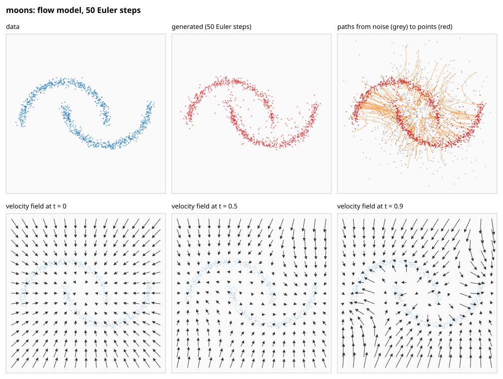
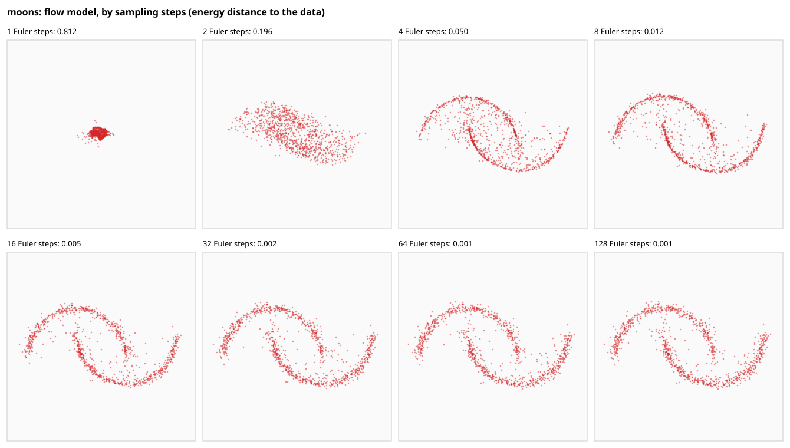

# Plan: building a diffusion model by hand

This project builds a small diffusion model piece by piece, in Rust, to
understand how image generation works: first on points in a plane, where
every step can be plotted, then on small images. It's the companion to
[tiny-llm-in-rust](https://github.com/jlinoff/tiny-llm-in-rust), which did
the same for a language model, and it starts from that project's
foundation: its matrices, automatic differentiation and file format,
copied here (see [Foundation](#foundation)).

The goal is understanding, not performance. Each stage is small enough to
read and runs on its own, and each arrives with its tests: this project
starts with `make test` and continuous integration in its first commit,
rather than adding them at the end (see [Design for test](#design-for-test)).

Technical terms are defined in [Terms](#terms), just below; tool and product
names are explained where they first appear.

**Contents** (generated from the headings by `make toc`; don't edit by hand)

<!-- toc -->
- [Terms](#terms)
  - [What a diffusion model does](#what-a-diffusion-model-does)
  - [Two ways to train one](#two-ways-to-train-one)
  - [Generating](#generating)
  - [The networks](#the-networks)
  - [Steering](#steering)
- [The flows](#the-flows)
  - [Training](#training)
  - [Generation (inference)](#generation-inference)
- [Order of work](#order-of-work)
- [Foundation](#foundation)
  - [Where it fits](#where-it-fits)
- [Design for test](#design-for-test)
- [How to read the figures](#how-to-read-the-figures)
- [Stage 2: points in a plane](#stage-2-points-in-a-plane)
  - [Where it fits](#where-it-fits-1)
  - [What was built](#what-was-built)
  - [Running it](#running-it)
  - [Predictions](#predictions)
  - [Exact fields, no network](#exact-fields-no-network)
  - [Results](#results)
- [Stage 3: images](#stage-3-images)
  - [Where it fits](#where-it-fits-2)
  - [What was built](#what-was-built-1)
  - [Where the weights are](#where-the-weights-are)
  - [Running it](#running-it-1)
  - [Choosing the patch size](#choosing-the-patch-size)
  - [Predictions](#predictions-1)
  - [Stage 3 results](#stage-3-results)
  - [What stage 3 taught](#what-stage-3-taught)
- [Stage 4: conditioning and guidance](#stage-4-conditioning-and-guidance)
  - [Where it fits](#where-it-fits-3)
  - [What it adds](#what-it-adds)
  - [How it will be tested](#how-it-will-be-tested)
  - [Predictions](#predictions-2)
  - [What was built so far](#what-was-built-so-far)
  - [Running it](#running-it-2)
  - [Stage 4 results](#stage-4-results)
- [Stage 5: looking inside](#stage-5-looking-inside)
  - [Where it fits](#where-it-fits-4)
- [Stage 6: text, later](#stage-6-text-later)
  - [Where it fits](#where-it-fits-5)
  - [How text diffusion works](#how-text-diffusion-works)
  - [Compared with tiny-llm-in-rust's model](#compared-with-tiny-llm-in-rusts-model)
- [Decisions](#decisions)
- [Where things live](#where-things-live)
- [Bibliography](#bibliography)
<!-- /toc -->

## Terms

Terms already defined in tiny-llm-in-rust's PLAN.md mean the same here
and aren't repeated: weights, tensor, gradient, loss, cross-entropy, backpropagation, automatic differentiation (the tape),
Adam, learning rate, batch, attention, GELU (the Gaussian error linear
unit, a smooth nonlinearity), transformer block, residual connection,
layer normalization, KV cache (key–value cache), checkpoint,
safetensors, and f32 and f64 (32- and 64-bit floating-point numbers).
Two more, used here: **BLAS** (Basic Linear Algebra
Subprograms, the standard interface for fast matrix products, here
Apple's Accelerate library on macOS) and **GFLOP** (a billion
floating-point operations; GFLOP/s, a billion per second).

### What a diffusion model does

- **generative model**: a model that produces new examples that look like
  its training data: new images of digits, say, not a label for an
  existing one. A language model is one too; it generates by predicting
  one token at a time.
- **noise**: random numbers, here drawn from a **Gaussian** (normal)
  distribution: mean 0, variance 1, independently for every number. An
  image of pure noise is static.
- **diffusion model**: a generative model that starts from pure noise and
  turns it into an example by many small steps, each a little less noisy.
  It's trained on the reverse: real examples with noise added, which is
  easy to make and comes with its own answer key (the noise that was
  added). The name comes from physics: adding noise step by step is like
  ink diffusing in water, and the model learns to run it backwards
  (Sohl-Dickstein et al. 2015).
- **time**, **t**: how far along the path from noise to data an example is.
  This project uses the convention of flow matching: t = 0 is pure noise,
  t = 1 is data. (DDPM, below, counts the other way: its t = 0 is data.)
- **noise level**: how much noise an example carries; it's a function of t.

### Two ways to train one

- **flow matching**, **rectified flow**: draw a data example x₁, a noise
  sample x₀ and a time t between 0 and 1; mix them in a straight line,
  x_t = (1 − t)·x₀ + t·x₁; and train the model to predict the direction of
  that line, x₁ − x₀, from x_t and t. The loss is the mean squared error
  between prediction and target (Lipman et al. 2023; Liu et al. 2023).
- **velocity**, **velocity field**: that predicted direction. As a
  function of position and time it's a field, like a wind map: at every
  point and moment, which way to move and how fast.
- **mean squared error** (**MSE**): the average of the squared differences
  between prediction and target, the loss for predicting numbers rather
  than choosing a token.
- **DDPM** (denoising diffusion probabilistic models; Ho et al. 2020): the
  original practical recipe. Noise is added over many steps (typically
  1,000) on a fixed **noise schedule**; the model predicts the noise ε
  that was added, and generation removes a little of the predicted noise
  at each of those steps, adding a little fresh noise back each time. It
  works, but slowly; flow matching is the simpler descendant that current
  image models such as Stable Diffusion 3 use (Esser et al. 2024).
- **DDIM** (denoising diffusion implicit models; Song et al. 2021): a faster
  way to generate from a DDPM-trained model, with no retraining. It visits
  a subsequence of the steps (say 50 of the 1,000), each jump estimating
  the clean example and re-noising it to the next level, and adds no
  fresh noise.

### Generating

- **ordinary differential equation** (**ODE**): an equation for how a
  quantity changes, here dx/dt = v(x, t): the position x moves along the
  velocity field. Generating with flow matching means solving it from
  t = 0 (noise) to t = 1 (a new example).
- **Euler step**: the simplest way to solve it: x ← x + v(x, t)·Δt, a short
  straight step along the current velocity. Twenty to fifty steps are
  typical; fewer give blurrier results, because the true path curves
  between steps.
- **sampling**: generating an example, in diffusion as in language models.
  Every starting noise gives a different example, the way every seed gave
  a different story.

### The networks

- **MLP** (multilayer perceptron): matrix products with a nonlinearity
  between them, nothing else. Big enough for points in a plane (stage 1).
- **time embedding**: t turned into a vector, by sines and cosines of t at
  several frequencies, so the network can tell nearby times apart. The
  same idea as tiny-llm-in-rust's position embeddings, applied to time.
- **patch**: a small square of an image, say 4 × 4 pixels. A 28 × 28 image
  is 49 patches; each becomes one token.
- **DiT** (diffusion transformer; Peebles and Xie 2023): a transformer whose
  tokens are an image's patches. Unlike a language model's, its attention
  isn't causal: every patch sees every other, since an image has no
  reading order. Its output is a velocity for every pixel.
- **adaptive layer normalization** (**adaLN**): how a DiT takes in the time
  (and later a class label): instead of learned constants, the scale and
  shift of each layer normalization are computed from the time embedding,
  so every block behaves a little differently at each noise level.

### Steering

- **conditioning**: giving the model extra information to generate from,
  such as which digit to draw.
- **classifier-free guidance** (Ho and Salimans 2022): train the model both
  with and without the condition (dropping it at random), then at
  generation compute both velocities and push further in the direction
  the condition adds: v = v_uncond + w·(v_cond − v_uncond), with a
  **guidance scale** w above 1. Larger w gives examples more clearly of
  the requested kind and less varied.

## The flows

There are two flows, as in tiny-llm-in-rust: training, which adjusts the
weights, and generation (inference), which uses them frozen. Both are the
same at every stage, whatever the data (points, images, later text).
"Step" means something different in each:

- a **training step** is one weight update: a batch of examples, a loss,
  a backward pass, Adam. Training takes thousands of them.
- a **sampling step** is one Euler step of generation: one pass through
  the network, with the weights frozen, moving the example a little way
  from noise towards data. Generation takes tens of them per example.

### Training

```
repeat, one training step at a time:
  x₁ = a batch of real examples
  x₀ = noise of the same shape; t = random in [0, 1], one per example
  x_t = (1 − t)·x₀ + t·x₁                 a point on each straight line
  loss = MSE(v(x_t, t), x₁ − x₀)          predicted velocity against the line's direction
  backward pass, then Adam adjusts every weight
```

Training never runs the ODE, and never takes a sampling step. Each
example is a single point on a straight line between some noise and some
data, and the model learns the direction of the line through that point.
Many different lines pass near any point, so what it learns is their
average direction there. Those averages make a velocity field whose
paths carry the whole noise distribution onto the whole data
distribution: the fact flow matching rests on (Lipman et al. 2023). The
model learns what to do at every moment of the journey without ever
making the journey.

Compared with tiny-llm-in-rust's training: there, one step scored the
next token at every position of a window; here, one step scores a
velocity for every example at its own random moment t. Both are
self-supervised, the answers coming free with the data: the next token
there, the noise that was added here.

### Generation (inference)

```
x = noise (x₀), the shape of one example
for t = 0, Δt, 2Δt, … < 1:                one sampling step each
    x = x + v(x, t)·Δt                     a short straight step along the velocity
x is a new example
```

Only generation runs the whole path, one Euler step at a time, with the
weights frozen. The number of steps is a choice: more follow the curved
paths more faithfully, fewer are faster and blurrier. Each new starting
noise gives a different example, as each seed gave a different story.

Compared with tiny-llm-in-rust's generation: both are repeated passes
through the network with the weights frozen, but there each pass added
one token and the length set the number of passes; here each pass
revises the whole example at once, and the number of passes is chosen.
There's also nothing to cache between passes: a KV cache kept earlier
tokens' keys and values because they never changed, but every part of
the example changes at every sampling step.

## Order of work

1. **Foundation** (done): the matrices, tape, BLAS support, random numbers
   and safetensors files, copied from tiny-llm-in-rust with their tests;
   `make test` and continuous integration from the first commit.
2. **Points in a plane** (done: see [Stage 2](#stage-2-points-in-a-plane)).
   Flow matching with a small MLP on 2D data (two
   interleaved half-moons, a spiral, a ring of Gaussians), each example two
   numbers. Training takes seconds; every step can be plotted as SVG (a
   text format for drawings that browsers display): the data, the learned
   velocity field as arrows, sample paths from noise to data, and how the
   result degrades with fewer Euler steps. Then DDPM on the same data, for
   comparison: what the 1,000 steps buy and cost.
3. **Small images** (done: see [Stage 3](#stage-3-images)). A DiT on
   28 × 28 grayscale digits (see [Decisions](#decisions) for the data): patches, attention
   without the causal mask, adaLN conditioning on time, a velocity per
   pixel. Grids of generated digits as image files, and the same picture
   at successive steps of one generation, noise sharpening into a digit.
4. **Conditioning and guidance** (next; its section is written before
   any code, with its predictions). The digit's class as a condition,
   and classifier-free guidance: "draw a 7", and what the guidance scale
   trades.
5. **Looking inside** (optional; see [Stage 5](#stage-5-looking-inside)):
   what the velocity field looks like at each t, which patches attend to
   which, and how early in generation the digit's identity is settled
   (stage 3's progress rows already answer that roughly: by t = 0.5).
6. **Text, later** (optional; see [Stage 6](#stage-6-text-later)): a
   masked diffusion language model on TinyStories (tiny-llm-in-rust's
   corpus of short, simple stories), reusing tiny-llm-in-rust's
   tokenizer, compared with tiny-llm-in-rust's model at the same size.

Each stage ends the way tiny-llm-in-rust's did: predictions written down
first, then the measurements, including the ones that turn out wrong.

## Foundation

### Where it fits

The project builds an image generator from nothing, to understand every
piece of it. Before anything about diffusion, a model needs matrices and
their products, a way to compute gradients so it can learn, random
numbers that can be reproduced, and a file to keep what it learned in.
tiny-llm-in-rust built and tested all four, so they are copied here
rather than rebuilt, and this project starts at diffusion itself.
Nothing in this section is specific to diffusion; every later stage
stands on it.

Copied from tiny-llm-in-rust's `transformer/src/` (each file says so at the
top), and checked by its own tests, which came along:

| File | What it holds |
|---|---|
| `tensor.rs` | row-major matrices, generic over f32 and f64; products split across threads, each element summed in a fixed order |
| `tape.rs` | reverse-mode automatic differentiation on whole matrices, every operation checked against finite differences |
| `blas.rs` | optional Apple Accelerate for the large f32 products (`--features blas`, the default on macOS) |
| `rng.rs` | SplitMix64 (a small, fast random number generator), with independent streams and normal draws |
| `safetensors.rs` | reading and writing model files, checked against one Hugging Face wrote |

Copying rather than depending on tiny-llm-in-rust keeps each project
standalone and free to change: diffusion needs a few things the language
model didn't, and they'll be added here:

- attention without the causal mask (stage 3), checked by **permutation
  equivariance**: without position embeddings, shuffling the input tokens
  must shuffle the outputs the same way and change nothing else;
- the mean squared error as a fused loss operation (added in stage 2);
- element-wise products and per-example scale and shift, for adaLN;
- SiLU (x·sigmoid(x)), the nonlinearity DiT uses alongside GELU.

The rest of tiny-llm-in-rust (tokenizer, causal model, generation with a KV
cache) has no counterpart here: a diffusion model has no tokens to predict
in order, so nothing to cache between passes.

## Design for test

tiny-llm-in-rust added its test harness after its first release; its
experiments had been checked by eye, and the checks became tests only
when that work stopped. Here every stage arrives with its tests, and
`make test` runs them all, as continuous integration does on every push.
The properties that make a project testable are built in from the start:
fixed seeds, results independent of the thread count, and exact resuming.

What each stage will test, beyond the gradient checks every new operation
gets:

- **flow matching against a closed form.** If the data is itself Gaussian,
  say one number from N(μ, s²) with noise N(0, 1), the ideal velocity has
  a formula: E[x₁ − x₀ | x_t] = μ + c(t)·(x_t − tμ), with c(t) =
  (t·s² − (1 − t)) / ((1 − t)² + t²·s²). Integrating it carries N(0, 1)
  exactly onto N(μ, s²). So the sampler can be tested with the true field
  before any network is trained (the samples' mean and spread must come
  out μ and s), and a trained network can be compared with the truth.
- **the interpolation and its target**: x_t at t = 0 is the noise and at
  t = 1 the data; the target is the same for every t on one line.
- **DDPM's forward process**: noised data has exactly the mean and variance
  the schedule says, measured on many draws.
- **patches**: cutting an image into patches and reassembling them gives
  back the same image, bit for bit.
- **non-causal attention**: permutation equivariance (above), and a
  gradient check.
- **a golden loss**, as in tiny-llm-in-rust: a fixed seed and model must
  reproduce recorded losses, so a change that quietly alters training
  fails a test.
- **generation is reproducible**: the same seed gives the same samples,
  whatever the number of threads.
- **files round-trip**: the image and plot writers produce what a reader
  gets back.
- **the documents themselves**: PLAN.md's table of contents and links, and
  every acronym in PLAN.md and README.md defined where it's first used
  (`tools/acronyms.py`; names that need no definition are listed in
  `tools/acronyms-known.txt`).
- **`make help`** lists every target and every variable meant to be set
  on the command line; lint fails if a variable is added to the Makefile
  without a line in the help.
- **formulas in the documents**: where PLAN.md gives a formula the code
  must obey, such as the DiT's parameter count, a test checks it
  against the code (`parameter_formulas_in_plan_md`).

Predictions are tests of understanding rather than of code, and they
follow a convention too: each stage writes its predictions before
measuring, records the misses beside the hits, and, from stage 4 on,
gives each prediction its mechanism and a quick numeric check of that
mechanism (why: [What stage 3 taught](#what-stage-3-taught), 7).

## How to read the figures

Every stage produces figures, and they're built to be read the same way.
This section is for a reader new to diffusion; it uses stage 2's figures
(`make stage2`, then open `out/*.svg` in a browser) as the examples.

**The picture to keep in mind: a wind map.** The trained network is a
wind map that changes with time: at every point and every moment t, which
way to blow and how hard (the velocity field). Generation releases leaves
at random spots (the noise) and lets the wind carry them from t = 0 to
t = 1; where they land is the result. The number of sampling steps is how
often each leaf checks the wind: with few steps, a leaf flies straight for
long stretches and misses the curves.

**Samples panels** (`generated`, and each panel of `-steps.svg`):

- **each dot is one generated example**, which began as one random point;
- **in a steps figure, every panel uses the same starting points and the
  same trained network**: only the number of steps changes, so every
  difference between panels comes from how coarsely the path was
  followed, not from the network;
- **what to look at**: the *shape* (are both moons there, all eight
  blobs?), the *sharpness* (thin, crisp arcs like the data's, or fuzzy?),
  *stragglers* (points stranded between the pieces: leaves that ran out of
  steps before arriving), and the *spread* (too wide is overshooting, too
  narrow is curves cut short);
- **the number in each title** sums all of that up: the energy distance to
  the real data (defined in [Stage 2](#stage-2-points-in-a-plane)), 0 when
  indistinguishable. Two samples of the data itself score about 0, the
  best any model can do.

**The paths panel**: each orange line is one leaf's whole trip, from its
grey starting point to its red landing point. Straight lines mean few
steps suffice, since a straight path needs no corrections; curved ones
need more.

**The velocity-field panels** show the network itself, the wind map at
three moments. At t = 0 every arrow points towards the middle: a point
that is pure noise says nothing about where its path leads, so the best
guess is the data's average. By t = 0.5 the arrows point towards the
nearest part of the data, and by t = 0.9 they pull hard onto it. That
progression is the "decision" being made over time: early steps settle
roughly where a point is going, late steps settle exactly where.

**Image grids** (stage 3: `sample-img`'s PNG files):

- **the samples grid** (`--png`, e.g. `out/digits.png`): 64 generated
  images, 8 across, each from its own random noise. The grid is only a
  way to see many at once; the images are unrelated to one another.
- **the progress grid** (`--progress`, e.g. `out/digits-progress.png`):
  the making of the first 8 of those images. Each *row* is one
  generation, and its 9 *columns* are snapshots at t = 0, 1/8, 2/8 … 1:
  the first column is the starting noise, the last the finished image.
  So the last column, read top to bottom, is the samples grid's first
  row, read left to right.
- **the real grid** (`--real`): 64 images from the training data, to
  compare with.
- **the same seed gives the same starting noise** (seed 2 by default), so
  samples from two checkpoints of one run, or from two models of the same
  image size, start from identical noise: each position in the grid shows
  how the same noise is turned into an image, and the difference between
  the grids is the training alone.

**The habit that makes them useful: ask what changed between two panels,
and what didn't.** The figures change one thing at a time (the steps, the
sampler, the training), so each difference can be traced to its cause.

**An example: the largest change is from 1 step to 2.** In
`moons-ddpm-steps.svg` the score falls from 6.7 to 0.19 between the first
two panels, a factor of 35, while every later doubling of the steps gains
a factor of 2 to 5. The cause is in the arithmetic of
DDIM's jump: each one estimates the clean point by dividing by √ᾱ at the
current step, so it multiplies any error in the network's noise
prediction by √(1 − ᾱ)/√ᾱ. At the start of generation, ᾱ₁₀₀₀ ≈ 0.00004,
so that factor is about 157:

- **with 1 step**, the whole journey is one blind jump: a 157-fold error,
  and no chance to correct it. The points land further from the data than
  the noise they started as;
- **with 2 steps**, the first jump goes only halfway, to step 500, where
  the error is scaled back down to about 43-fold, and then a second step
  looks again: the network sees where the first jump landed, predicts the
  noise from there, and finishes from much nearer the truth.

The first extra look matters most because it's the first chance to
correct anything; after that, more steps refine an answer that's already
roughly right. Flow's figure shows the same shape less extremely (0.81 to
0.20): its single step lands everything on the mean, a bad but not wild
answer, since flow's velocity has no division by a small number.

## Stage 2: points in a plane

### Where it fits

The whole idea of diffusion, shown where everything can be seen. A
diffusion model learns a velocity field that carries noise to data, and
generates by following it. With examples of two numbers each, the data,
the learned field and the paths from noise to data can all be drawn on
one page, and for Gaussian data the true field has a formula to check
the network against. The network is a small MLP; flow matching comes
first, then DDPM, the original recipe, for comparison. Everything after
is this same idea with bigger data and a bigger network: stage 3 swaps
the points for images and the MLP for a transformer, and keeps the
training loop and the sampler. This stage also settled flow matching as
the method for the rest ([Decisions](#decisions), 6).

### What was built

- `data2d.rs`: the four data sets (moons, spiral, rings, gaussian),
  unlimited and reproducible, and Gaussian noise.
- `flow.rs`: the interpolation, the target, the Euler sampler, and the
  exact velocity field for Gaussian data.
- `ddpm.rs`: DDPM's schedule, its forward process, its ancestral sampler,
  DDIM's sampler, and the exact noise prediction for Gaussian data.
- `mlp.rs`: the network, with the time embedding: 35,842 parameters at
  the defaults (width 128, 3 hidden layers, 8 sine-cosine pairs).
- `optim.rs` (Adam), `train2d.rs` (training), `svg.rs` (plots),
  `metrics.rs` (the energy distance, below), and the tape's new fused
  mean-squared-error operation.
- Commands: `diffusion train2d`, `sample2d`, `steps2d` and `exact`, and
  `make` targets for each data set (next).

### Running it

One `make` target per data set trains flow matching on it and draws both
figures; each takes under a minute on the M4:

| Command | Trains | Figures in `out/` |
|---|---|---|
| `make moons` | flow on two half-moons | `moons-flow.svg`, `moons-flow-steps.svg` |
| `make spiral` | flow on a spiral | `spiral-flow.svg`, `spiral-flow-steps.svg` |
| `make rings` | flow on eight blobs in a ring | `rings-flow.svg`, `rings-flow-steps.svg` |
| `make gaussian` | flow on one Gaussian, the case with an exact answer | `gaussian-flow.svg`, `gaussian-flow-steps.svg` |
| `make moons-ddpm` | DDPM on the moons, for comparison | `moons-ddpm.svg`, `moons-ddpm-steps.svg` |
| `make exact` | nothing: the samplers with the exact Gaussian fields | a table, printed |
| `make stage2` | all of the above but `gaussian` | |

Any data set with either objective can be asked for by its file name:
`out/<data>-<objective>.svg` (samples, paths and, for flow, the velocity
field) and `out/<data>-<objective>-steps.svg` (samples by number of
steps), with `<data>` one of moons, spiral, rings or gaussian and
`<objective>` flow or ddpm; for example `make out/spiral-ddpm-steps.svg`.
The model goes in `out/<data>-<objective>.safetensors`, and
`TRAIN2D_ARGS` passes options to training, as in
`make moons TRAIN2D_ARGS='--steps 2000 --width 64'` (every option:
`diffusion/target/release/diffusion train2d --help`).

**Measuring a result: the energy distance.** For generated points X and
data points Y it's 2·mean|x − y| − mean|x − x′| − mean|y − y′|, over all
pairs (Székely and Rizzo 2013): zero only when the two distributions are
the same, and growing as they differ in location, spread or shape. Two
independent samples of the same data set give its floor, a little above
zero; a result near the floor is as good as this measure can tell.

**Why the loss doesn't fall to zero.** Many straight lines pass through
any point, each with its own direction x₁ − x₀; the network can only
predict their average, and the spread of the directions around it is
loss nothing can remove. So a flow model's loss levels off well above
zero even when its velocity field is right, unlike a language model's
loss, whose floor is the text's own unpredictability. The level says
little on its own; the samples are the measure.

### Predictions

Written before the samples were measured (the exact-field table below,
which needs no training, came first and shaped the third):

1. **One Euler step puts every sample at the data's mean.** At t = 0 a
   point says nothing about where its line leads, so the ideal velocity is
   the mean minus the point (a test checks this for the exact Gaussian
   field). For moons, centered at the origin, one step should give a tight
   cluster there, not two moons.
2. **The distance to the data falls with the number of steps and levels
   off** near the floor by 32 to 64 Euler steps.
3. **With few steps, samples come out too concentrated**, pulled in from
   the true shape, as the exact field's Euler steps are.
4. **DDIM needs about twice as many steps as flow's Euler steps** for the
   same quality, as with the exact fields; DDPM's ancestral sampler, with
   all 1,000 steps, is as good as either at its best.
5. **Every blob of rings is covered**: nothing in the training makes a
   model drop a blob.

### Exact fields, no network

`diffusion exact`: Gaussian data (standard deviations 0.5 and 0.8), the
exact velocity and noise predictions, and only the samplers' own error.
The samples' standard deviations:

| Steps | Flow, Euler | DDPM, DDIM |
|---|---|---|
| 1 | 0.000, 0.000 | 0.002, 0.004 |
| 2 | 0.201, 0.389 | 0.072, 0.177 |
| 5 | 0.371, 0.612 | 0.264, 0.512 |
| 10 | 0.433, 0.699 | 0.372, 0.645 |
| 25 | 0.474, 0.757 | 0.447, 0.733 |
| 50 | 0.488, 0.777 | 0.474, 0.764 |
| 100 | 0.495, 0.787 | 0.488, 0.781 |
| 250 | 0.499, 0.793 | 0.497, 0.790 |
| 1000 | 0.502, 0.796 | 0.501, 0.795 |

Both samplers start too narrow and converge as the steps increase: the
paths curve, and a straight step cuts the corner inwards. DDIM's error at
any step count is about that of flow's Euler at half as many: flow at 25
steps (0.474) matches DDIM at 50. One step collapses everything onto the
mean, for both, exactly as the formula says. All of this is the sampler
alone, before any network adds errors of its own.

### Results

Trained with the defaults (5,000 steps of 256 points, learning rate
0.002, 35,842 parameters): about 46 seconds each in this project's cloud
workspace (2 cores, about 110 steps per second). `make stage2` reproduces
everything; the figures are `out/*.svg`, and the two for moons are in
`docs/`.



**Moons, by sampling steps** (`diffusion steps2d`; energy distance to the
data, 2,000 points; two samples of the data itself give −0.0013, an
estimate that can dip just below zero):

| Steps | Flow, Euler | DDPM, DDIM |
|---|---|---|
| 1 | 0.812 | 6.707 |
| 2 | 0.196 | 0.188 |
| 4 | 0.050 | 0.086 |
| 8 | 0.012 | 0.015 |
| 16 | 0.0047 | 0.0049 |
| 32 | 0.0024 | 0.0031 |
| 64 | 0.0013 | 0.0028 |
| 128 | 0.0009 | 0.0026 |
| 1,000 (DDPM's ancestral) | | 0.0014 |



Rings and spiral, by flow at 50 steps: −0.0003 and −0.0001, both at their
data's floor.

**The predictions, checked:**

1. **One step puts every sample at the mean: right.** A tight cluster at
   the origin (the figure's first panel), and the velocity field at t = 0
   points from everywhere towards the middle, as the formula says.
2. **The distance falls and levels off by 32 to 64 steps: right.** 0.0024
   at 32, 0.0013 at 64, near the floor.
3. **Few steps give samples that are too concentrated: half right.** At 4
   and 8 steps each moon is a thin, sharp curve, narrower than the data's,
   as predicted; but the larger error is something else: stragglers
   scattered across the gap between the moons, points whose paths were
   cut short before they reached either one. The exact Gaussian, with
   only one blob, had no gap to strand them in.
4. **DDIM needs twice flow's steps: wrong.** From 2 to 16 steps the two
   are about equal. DDIM differs at the ends instead: one step explodes
   (6.7, points scattered far outside the window), and from 32 steps on
   it levels off higher (about 0.003 against flow's 0.0009). The
   explosion has a clear cause: DDIM's single jump from step 1,000
   estimates the clean point by dividing by √ᾱ₁₀₀₀ ≈ 0.006, which
   multiplies any error in the network's noise prediction by about 150.
   With the exact prediction there's no error to multiply, and it
   collapsed onto the mean like flow. The higher plateau is likely the
   same effect in milder form, the noise prediction's errors at high
   noise amplified, but that's a guess, not a measurement. DDPM's
   ancestral sampler, with all 1,000 steps, beats DDIM's best (0.0014),
   but not flow's at 64 steps or more, with a twentieth of the passes.
5. **Every blob of rings is covered: right.** All eight, with a few
   stragglers along the circle between them.

**What the pictures add.** Flow's paths are nearly straight lines from
noise to data (the figure's third panel), which is why so few steps
suffice: a straight path is followed exactly by a single Euler step, and
it's the bends that need more. The velocity field shows when the decision
is made: at t = 0 every arrow points towards the middle, at t = 0.5 the
arrows already point towards the nearest part of the data, and by
t = 0.9 they pull hard onto it, with the field between the moons (or
rings' blobs) splitting points to one side or the other.

**The losses** level off at 1.51 (moons), 1.82 (rings) and 1.45 (spiral)
for flow, and 0.23 for DDPM on moons, which predicts a different target
(the noise, not the velocity). As above, these floors are the spread of
the targets, not the model's error, and they don't compare across data
sets or objectives.

## Stage 3: images

### Where it fits

The step from a toy to real images: handwritten digits of 28 × 28
pixels, 784 numbers per example, far too many to draw a field for. The
network becomes a diffusion transformer (DiT), which cuts each image
into patches and lets attention relate them; the training loop and the
Euler sampler are stage 2's. The questions: does the idea carry over to
images, what do the patch size and the number of steps trade, and what
does the model learn first? Its limit is the starting point of stage 4:
the model can't be told which digit to draw, and about a third of its
samples land between digits.

### What was built

- **The tape's new operations**: attention without the causal mask
  (checked against finite differences, and for **permutation
  equivariance**: with no position information, shuffling the tokens
  shuffles the outputs and changes nothing else, which is why the DiT
  needs position embeddings), SiLU, column slices, and adaLN's per-image
  scale, shift and gate.
- `image.rs`: patches and back, bit for bit, at any size; the IDX reader
  for MNIST and Fashion-MNIST (IDX: the files' simple format, a header of
  dimensions, then one byte per pixel); a synthetic data set of shapes
  (squares, discs and crosses) at any size and channel count; PNG
  (Portable Network Graphics) files and grids of images, with the
  format's checksums, CRC-32 (a cyclic redundancy check) and Adler-32,
  checked against their standard test values.
- `dit.rs`: the DiT of [Terms](#terms), with **adaLN-Zero**: the layers
  computing each block's scale, shift and gate start at zero, so every
  gate starts closed, every block starts as the identity, and the
  untrained model predicts exactly 0 (a test checks it). Its gradients
  are checked against finite differences, whole.
- `trainimg.rs` and the commands `diffusion train-img` and `sample-img`:
  flow matching on images (not DDPM: [Decisions](#decisions), 6), checkpoints every 1,000 steps (so a long run
  can be sampled while it continues), grids of samples, real images for
  comparison, and the progress of single generations from noise to image.
- `make digits` and `make fashion` download the data and train; `make
  shapes` needs no download.
- **Watching a run as it trains**: `make peek` (in a second terminal)
  samples from the latest checkpoint into `out/peek.png` and
  `out/peek-progress.png`, the same as

  ```
  diffusion/target/release/diffusion sample-img --model out/digits.safetensors \
      --png out/peek.png --progress out/peek-progress.png
  ```

  It uses the same seed every time, so successive peeks start from the
  same noise and show the training alone; `PEEK_MODEL=` picks another
  run. (How to read the two images: [How to read the
  figures](#how-to-read-the-figures), Image grids.)

**The default DiT**: width 128, 6 blocks, 4 heads, 4 × 4 patches (49
tokens of 16 values for MNIST): 1,843,344 parameters, against Decision
3's guess of 1.2 million. The guess counted the attention and
feed-forward weights (12d² per block) but not adaLN's, a d × 6d matrix per
block, half as many again.

### Where the weights are

**A training step**, repeated 20,000 times: take 128 real images and
128 images of pure noise, with a random time t for each pair; mix them,
x_t = (1 − t)·noise + t·image; cut each mixture into patches; the model
predicts the velocity, image − noise, for every pixel; the mean squared
error against the true velocity is backpropagated, and the optimizer
(Adam, as in tiny-llm-in-rust) nudges every weight a little. At the end
only the weights are saved, 1.8 million numbers in
`out/digits.safetensors`, and no images. What they encode is a
function: given any noisy image and a time, which way to move towards
real images. Generating is asking that function for a direction 50
times, from fresh noise, taking a small step each time.

**A patch is a token, but it has no weights of its own.** In
tiny-llm-in-rust a token is an ID (identifier: a number naming one
entry) in a vocabulary, and the model looks
up that ID's row in an embedding table: one learned vector per word.
Patches have no vocabulary: they are 16 continuous pixel values, and the
same patch never occurs twice. So instead of a lookup, every patch is
multiplied by one shared matrix, 16 pixel values to d = 128 numbers,
and at the end one shared matrix turns each token's 128 numbers back
into 16 values, the velocity of its pixels. (A language model ends
differently: a probability for every word of its vocabulary.)

Where the 1,843,344 parameters of the default DiT sit, with the formula
for each in the hyperparameters: d the width (128), B the blocks (6),
p the patch side (4), c the channels (1), v = p²c the values per patch
(16), N = (H/p)(W/p) the tokens for an H × W image (49), and k the time
frequencies (8):

| Weights | Formula | With the defaults | Parameters | Used by |
|---|---|---|---|---|
| Patch matrix and bias: 16 pixel values (v) to 128 numbers (d) | (v + 1)d | (16 + 1) × 128 | 2,176 | every patch |
| Position vectors: one row of 128 (d) for each of 49 positions (N) | Nd | 49 × 128 | 6,272 | one position each |
| Time network: t, then a sine and a cosine at each of 8 frequencies (k), 17 numbers, through two layers to 128 | (2k + 2)d + d² + d | 18 × 128 + 128² + 128 | 18,816 | every patch |
| 6 blocks (B): adaLN 6d² + 6d, attention 4d² + 4d, feed-forward 8d² + 5d | B(18d² + 15d) | 6 × (18 × 128² + 15 × 128) | 1,780,992 | every patch |
| Final adaLN and output matrix: 128 numbers to 16 | 2d² + 2d + (d + 1)v | 2 × 128² + 2 × 128 + 129 × 16 | 35,088 | every patch |
| **Total** | B(18d² + 15d) + 3d² + (2v + N + 2k + 6)d + v | 6 × 296,832 + 3 × 128² + 103 × 128 + 16 | **1,843,344** | |

The same total for another model, by example. The 7 × 7 run changes only
the patch side, so v = 7² × 1 = 49 and N = (28/7)² = 16:
6 × 296,832 + 3 × 128² + (2 × 49 + 16 + 2 × 8 + 6) × 128 + 49
= 1,780,992 + 49,152 + 17,408 + 49 = 1,847,601. A wider model, d = 256
with everything else at the defaults: 6 × (18 × 256² + 15 × 256) +
3 × 256² + 103 × 256 + 16 = 7,077,888 + 23,040 + 196,608 + 26,368 + 16
= 7,323,920: about four times the parameters for twice the width.

Inside a block: adaLN is one d × 6d matrix with its bias, making the six
modulation vectors (a scale, a shift and a gate for attention, and the
same for the feed-forward layer); attention is the d × 3d matrix making
queries, keys and values plus the d × d projection back; the
feed-forward layer is d × 4d and 4d × d, with biases. The number of
heads changes none of these: it splits the same d columns into groups.
The total is dominated by the 18Bd² of the blocks, so doubling the width
nearly quadruples the model, while the image size enters only through
N, one row of d per token. A test (`parameter_formulas_in_plan_md`, in
`dit.rs`) checks every formula here against the model's actual layout.

97% of the weights are in the blocks, and they treat every patch alike.
The only weights belonging to a place are the position vectors, 49 rows
saying "this is the patch at row 2, column 5". So the model does not
know "what patch 17 looks like"; it knows how strokes in neighbouring
patches fit together, and that is attention's work. It is also why the
7 × 7 model is almost the same size (1,847,601): its patch and output
matrices grow from 16 values to 49, its position table shrinks from 49
rows to 16, and the blocks are unchanged.

### Running it

| Command | Trains | Images in `out/` |
|---|---|---|
| `make shapes` | a small DiT on synthetic 16 × 16 shapes, no download: minutes | `shapes.png`, `shapes-progress.png`, `shapes-real.png` |
| `make digits` | the default DiT on MNIST (downloaded into `data/mnist`): 1–2 hours on the M4 | `digits.png`, `digits-progress.png`, `digits-real.png` |
| `make digits-p7` | the same with 7 × 7 patches: about half an hour | `digits-p7.png`, … |
| `make fashion` | the default DiT on Fashion-MNIST (`data/fashion`) | `fashion.png`, … |
| `make peek` | nothing: samples from a running model's latest checkpoint | `peek.png`, `peek-progress.png` |

`IMG_ARGS` passes options to training for digits and fashion, as in
`make digits IMG_ARGS='--steps 5000'`, and `SHAPES_ARGS` replaces the
shapes run's (size, width and so on: `diffusion train-img --help` lists
them). An image model is retrained only on purpose, with `make -B`: a
code change doesn't trigger a run of an hour or more. To sample a model
differently (more images, fewer steps, another seed):
`diffusion/target/release/diffusion sample-img --model out/digits.safetensors
--steps 10 --png out/digits-s10.png` (every option: `sample-img --help`).

### Choosing the patch size

The patch size is a **hyperparameter**: a setting chosen before training,
not learned (as the width and the number of blocks are). Patches here are
square, and the side must divide the image's: for 28 × 28 the choices are
sides of 1, 2, 4, 7, 14 or 28 pixels, so the realistic alternatives to the
default 4 × 4 are 2 × 2 and 7 × 7.

| Patch | Values per patch | Tokens | Cost per step, relative |
|---|---|---|---|
| 2 × 2 | 4 | 196 | about 4–5× (attention alone 16×) |
| 4 × 4 (default) | 16 | 49 | 1× |
| 7 × 7 | 49 | 16 | about ⅓ |

What the choice trades:

- **Compute.** The matrix products cost in proportion to the tokens,
  attention in proportion to their square. On the M4, 2 × 2 patches would
  turn a 1½-hour MNIST run into 6 to 8 hours; 7 × 7, into about half an
  hour.
- **Detail per token.** Each patch enters through one matrix (its pixels
  to d numbers) and leaves through another (d numbers back to its
  pixels). A 7 × 7 patch must pack 49 pixels into one vector and produce
  all 49 back out of it, so fine detail inside a patch is harder to get
  right; the classic symptom is **block seams**, strokes that step or
  break at the patch boundaries. (Measured, this mattered less than
  argued here: with d = 128, a token has more numbers than a 7 × 7
  patch has pixels, so nothing needs packing, and the 7 × 7 run lost
  its seams by the end: [Stage 3 results](#stage-3-results), prediction
  6.)
- **What attention can relate.** Attention connects patches. With small
  patches, how neighbouring bits of a stroke fit together is attention's
  job, the transformer's strength; with large ones, it's left to the
  single matrix in and out.
- **The evidence**: the DiT paper found exactly this trade, smaller
  patches giving better images at more compute (Peebles and Xie 2023).
  Its best model used 2 × 2 patches, on a 32 × 32 grid of compressed
  image features rather than raw pixels: 256 tokens.

4 × 4 is the middle choice for 28 × 28: few enough tokens for a run of
under two hours on the M4, small enough patches for seams not to
dominate. `make digits-p7` trains the same model with 7 × 7 patches, for
the comparison (prediction 6, below).

### Predictions

Written before any images were generated:

1. **Speed.** In this project's cloud workspace (2 cores, no Accelerate)
   the default DiT trains at about 25 images per second, 5 seconds a step
   of 128: too slow for MNIST here. On the M4, with about 20 times the
   arithmetic (10 cores at the speed tiny-llm-in-rust measured, plus
   Accelerate), about 0.3 seconds a step, so 20,000 steps in about 1½ to 2
   hours: faster than Decision 3's "a few hours", because the M4's
   measured throughput is higher than the guess assumed.
2. **Digits appear early.** Recognizable digits by a few thousand steps,
   with blurry, broken strokes; clean ones by the end. Some samples will
   be ambiguous blends (a 4 that's half 9): nothing tells the model which
   digit to draw until stage 4.
3. **The progress rows settle coarse to fine**, as the velocity field of
   stage 2 did: by t = 0.5 the rough shape and position of the digit are
   fixed; the last steps sharpen edges.
4. **Fewer steps blur.** At 10 Euler steps the digits survive but soften;
   at 2 to 4 steps they smear towards an average digit, a grey blob,
   stage 2's one-step collapse onto the mean in image form.
5. **Fashion-MNIST is harder**: with the same model and steps, its
   samples look worse than the digits do, because clothing has texture
   and more varied shapes than strokes on a blank page.
6. **7 × 7 patches: recognizable digits with visible blocking.** About a
   third of the time per step, and digits still recognizable, but with
   strokes stepped or misaligned at the 7 × 7 boundaries, which 4 × 4
   patches don't show as clearly.

### Stage 3 results

**Speed (prediction 1): right.** On the M4, the default DiT trains on
MNIST at about 435 images per second, 0.29 seconds a step of 128, so
20,000 steps take 1 h 36 min: inside the predicted 1½ to 2 hours, and
about 18 times this cloud workspace's 25 images per second.

**Synthetic shapes, a check of the whole pipeline** (no prediction was
written for these; `make shapes`: 16 × 16, a DiT of width 64, 4 blocks,
16 tokens, 315,536 parameters, at 350 images per second here):

- *3,000 steps (9 minutes)*: every sample is one white shape on black,
  of a plausible size and place, but blobby: no crisp squares, discs or
  crosses. 10 Euler steps look almost the same as 50 (the paths are
  nearly straight, as in stage 2); 2 steps give grey smudges.
- *12,000 steps (38 minutes)*: much crisper; recognizable crosses,
  squares and discs among them, so the blobs were mostly a matter of
  training time. Two failures remain: shapes cut off along straight
  lines that fall on the 4-pixel patch boundaries (the block seams of
  [Choosing the patch size](#choosing-the-patch-size)), and the odd
  fragment or empty image. The loss went from 0.249 to 0.202.

**MNIST at step 2,000** (a checkpoint, a tenth of the run): strokes
already, a few recognizable digits (1s, a 3, a 5, a 2) and many
digit-like blends. Prediction 3 (coarse to fine) holds: each digit's
shape and position appear by t = 0.5 and barely move after. Prediction 2
is on track with a different flavour than predicted: the strokes are
broken and speckled but not blurry. The model has learned MNIST's
texture (pure black, fully white strokes) before its structure (strokes
that join into a whole digit), which needs distant patches to agree:
attention's job, and the slower thing to learn.

**MNIST at steps 6,000 and 10,000** (checkpoints; 10,000 is halfway).
The strokes join up. At 6,000 many samples are recognizable digits and
the rest malformed. At 10,000 the strokes are thicker and continuous,
with the speckle mostly gone, and by a quick count about half of the 64
samples are clear digits (0, 1, 2, 5, 7, 8 and 9 among them). The rest
are digit-like scribbles: a loop with a stray tail, two strokes that
don't meet, a shape with an arrowhead, a few dots left beside a stroke.
The same starting noise can become a different digit at a later
checkpoint: training moves the velocity field, the boundaries between
the regions of noise that flow to each digit move with it, and a
starting point near a boundary changes sides. Prediction 3 holds at
every checkpoint: in the progress rows the digit is decided by the
middle column, and the later columns only clean it up.

A prediction for the end of the run, written at step 10,000: more clear
digits, perhaps two-thirds, but scribbles remain. The second half of
the run mostly polishes. Its learning rate is now about 57% of the peak
and falls to 10% by the end, so the model takes ever smaller steps
instead of learning new structure, and a 1.8-million-parameter model
that isn't told which digit to draw will keep producing some shapes
that lie between digits.

**MNIST at the end, step 20,000** (1 h 35 min; mean loss over the last
500 steps 0.1774, against 0.187 at step 10,000). The end-of-run
prediction was about right, a little on the generous side: by a quick
count about 40 of the 64 samples are clear digits, every digit from 0
to 9 among them, against about half at step 10,000. The strokes are
smoother and more even, and the stray dots are nearly gone. The
remaining third are what predicted: blends (an *a* that's half 9, a 9
that's half 4), and a handful of scribbles that aren't any digit. Set
beside `digits-real.png`, the generated strokes are slightly thicker
and wobblier than real handwriting, and no block seams are visible at
4 × 4 patches. The samples use the same starting noise as the
checkpoint grids, so the same cell can be compared across the run. In
the first row, the dotted, broken 3 of step 10,000 is now one clean
stroke; the 9 has closed into an 8; and the arrowhead scribble is a
slanted 1: more starting points changing sides as the field moved. The
progress grid shows the same coarse-to-fine order as every checkpoint:
each digit is decided by t = 0.5 and only sharpened after.

Against the predictions so far:

- **2, digits appear early: right on timing, half right on the end
  state.** Digits were recognizable by step 2,000 and most were by
  6,000, as predicted, though the early flaw was broken, speckled
  strokes rather than blur. "Clean ones by the end" holds for about
  two-thirds of samples, not all; the ambiguous blends predicted are
  there.
- **3, coarse to fine: right**, at every checkpoint and at the end.
- **4, fewer steps blur: wrong at 4 steps, and the softening at 10
  barely shows.** At 10 Euler steps the grid is almost the same as at
  50, cell for cell. At 4 steps nothing smears towards a grey average:
  every cell still holds the same digit as at 50 steps, in the same
  place, but the strokes are thinner and ragged, with faint doubled or
  ghost strokes beside them. The likely reason is that, as with the
  shapes, the learned paths are nearly straight, so even 4 straight
  steps follow them closely; where a path does bend, as when the model
  is still choosing between two strokes, a big step heads for a blend
  of both, and that blend shows up as a faint second stroke rather than
  as blur. The collapse onto the average image is a one-step effect:
  the first step, from pure noise, can only head for the mean of all
  digits.

  That explanation made a prediction of its own, written after the
  4-step grid and before these were run: 1 step gives the same blurry
  average digit in every cell, and 2 steps is where separate digits
  appear. Both held. At 1 step all 64 cells are one grey blob, MNIST's
  mean image (a faint 0, 8 and 9 laid over each other), whatever the
  starting noise: at t = 0 the noise says nothing about which image it
  will become, so the best velocity is the mean image minus the noise,
  and one full step lands exactly on the mean, as stage 2's Gaussian
  did. At 2 steps each cell already holds its own digit, mostly the
  same one as at 50 steps, but drawn as a tangle of several overlaid
  strokes, the candidates not yet resolved. The whole sequence: 1 step
  the mean, 2 steps tangled blends, 4 steps ghost strokes, 10 steps
  close to 50.
- **6, 7 × 7 patches: right on speed, wrong on blocking.** The run took
  26 min 27 s at about 1,620 images per second, 3.6 times faster than
  4 × 4's 1 h 35 min, a little better than the predicted third of the
  time (16 tokens instead of 49 cut the matrix products about 3 times
  and attention about 9 times). Blocking was plain at step 1,000:
  digits built from rectangular slabs, strokes cut off along the
  7-pixel grid, specks at patch corners. By step 10,000 it had mostly
  trained away, and at the end no seams are visible. By a quick count
  about 44 of the 64 samples are clear digits, as many as with 4 × 4
  patches or a few more, and the 7 × 7 run was ahead of the 4 × 4 run
  at step 10,000.

  The loss disagrees with the eye: 0.1935 over the last 500 steps,
  against 4 × 4's 0.1774, and behind at every step of the run. The
  loss is the error of the velocity at every pixel and every t,
  including the noisy middle of the path, where an error doesn't show
  in the finished image; 9% more of it buys nothing visible at 28 × 28.
  The likely reason for the miss is in [Choosing the patch
  size](#choosing-the-patch-size): the argument assumed a patch must be
  packed into its token, but a token of 128 numbers holds a 7 × 7
  patch's 49 pixels with room to spare, and MNIST's smooth strokes are
  easy for one matrix in and out to draw. The DiT paper's advantage for
  small patches came on larger images and from more compute per image;
  on 28 × 28 digits at this width, 4 × 4 patches cost 3.6 times as much
  for a lower loss and no visible gain.

**The same noise gives the same digit, whatever the patch size.** The
4 × 4 and 7 × 7 models were trained separately, with different
architectures, yet from the same starting noise they draw mostly the
same digit in the same cell: the first row reads 7 9 · 0 1 · · 2 in
both. They share the data and the training noise, and flow matching
defines the target velocity field by the data, not the network, so two
networks that learn it well enough carry the same noise to the same
image. Which noise becomes which digit is a property of the data and
the method, not of the model.

**Fashion-MNIST** (the default DiT, 1 h 32 min, as long as the digits
take; mean loss over the last 500 steps 0.2330). The loss can't be
compared with the digits' 0.1774: the floor depends on the data, and
clothing lights far more of the image, more variably, than a thin
stroke does, so even a perfect model would score higher on it.

- **5, Fashion-MNIST is harder: wrong as written, right about detail.**
  As objects, the samples look *better* than the digits: by a quick
  count about 54 of the 64 are clearly a sweater, trousers, a T-shirt,
  a dress, a boot, a sneaker, a sandal or a bag, against about 40 clear
  digits, and nearly every silhouette is right. What is worse is fine
  detail. The real images carry printed text, faces, stripes and
  patterns; the samples turn these into grey mottling. Sandal straps
  and heels come out tangled, and a handful of samples are hybrids or
  garbled (a bag that is half shoe, a shape that is no garment at all).

  Why the prediction failed: it judged difficulty by the data's
  complexity, but what we judge is recognizability, and that depends
  on the class. A digit is a few thin strokes whose topology is its
  identity: one stroke too short turns a 4 into a 9 or into nothing. A
  garment is a large, centred silhouette, and its class survives a
  wrong edge or a smeared print. So clothing is harder to reproduce
  exactly and easier to reproduce recognizably.

The progress rows settle coarse to fine more plainly still: the
silhouette is visible by t = 0.375 to 0.5, earlier than the digits,
because a large bright region is most of the image, and textures and
prints are the last thing to appear.

### What stage 3 taught

Beyond the scores, seven things.

1. **The image is decided early; the rest of the path cleans it up.**
   At every checkpoint, with both patch sizes and on both data sets,
   the progress rows fix what the image is, and where, by t = 0.5. The
   fewer-steps ladder shows the same from the other side: 1 step gives
   the mean image, 2 steps a tangle of candidates, 4 steps ghost
   strokes, 10 steps nearly the same as 50. A sampler with too few
   steps fails by leaving choices unresolved, not by blurring, and
   because flow matching's learned paths are nearly straight, 10 steps
   are almost free.
2. **Which noise becomes which image belongs to the data and the
   method, not the model.** Two architectures, trained separately,
   carried the same noise to mostly the same digits; within one run,
   noise near a boundary between digits changed sides as training moved
   the field. The network approximates a map the data and flow matching
   already define.
3. **Loss is a weak guide to what the eye sees**, three ways. The last
   10,000 steps of the 4 × 4 run cut its loss by only 5% and took clear
   digits from about half to about two-thirds; 4 × 4 and 7 × 7 differ by
   9% in loss and not at all to the eye; and the loss can't compare
   data sets, since its floor depends on the data. The loss averages
   the velocity's error over every pixel and every t, and much of that
   error lives in the noisy middle of the path, where it never reaches
   the finished image. So a run must be judged by looking at it. (Larger
   projects use measures designed to agree with human judgement of
   images for this reason.)
4. **What is cheap is learned first.** On digits, the early checkpoints
   had MNIST's local look, black background and fully white strokes,
   long before the strokes joined into digits: local statistics are
   cheap, agreement between distant patches is attention's work and
   comes later. On clothing, the silhouette, most of the image, comes
   first and the prints last. (Fashion was only sampled at the end, so
   this is seen in its progress rows, not in its checkpoints.)
5. **"Harder" depends on what is judged.** Clothing is harder to
   reproduce exactly and easier to reproduce recognizably, because a
   digit's identity is the topology of a few strokes and a garment's is
   a large silhouette (prediction 5).
6. **Lessons from the literature don't transfer across scales by
   themselves.** The DiT paper's case for small patches is sound for
   its large images of compressed features, where compute is the limit;
   on 28 × 28 pixels with tokens of 128 numbers, a 7 × 7 patch's 49
   pixels fit with room to spare, and 7 × 7 patches gave the same images
   for 28% of the compute (prediction 6).
7. **How the predictions fared, and a convention that follows.** The
   predictions that held were extrapolated from measurements of this
   code: the speed, from measured throughput (and the run times to the
   minute); coarse to fine, seen already in stage 2. The ones that
   failed borrowed a conclusion by analogy: DDPM's few-step blur for a
   flow model, the DiT paper's patch sizes for another regime,
   "undertrained image models are blurry" for a model that predicts a
   velocity, "complex data looks worse" for a judgement of
   recognizability. Prediction 6 needed only one line of arithmetic
   (128 > 49) to be caught. So from stage 4 on, each prediction states
   its mechanism and a quick numeric check of it, before the run.

And one about the engineering: sampling with a fixed seed was chosen so
that successive peeks show the training alone. It is also what made the
comparisons of 1 and 2 possible, across checkpoints and across models:
an unplanned payoff of designing for test.

## Stage 4: conditioning and guidance

### Where it fits

The step from generating something to generating what was asked for: the
digit we want as an extra input, and guidance to strengthen its effect,
the mechanism text-to-image systems use, at small scale. It reuses stage
3's DiT and training, with the patch size chosen from stage 3's results
([Decisions](#decisions), 7), and adds a measuring instrument, a digit
classifier, so that results are counted rather than judged by eye. With
it the generator is complete in the sense the project set out to reach:
noise in, the requested image out.

Written before any code: the plan, the tests, and the predictions, each
with its mechanism and a numeric check (the convention from
[What stage 3 taught](#what-stage-3-taught), 7). Developed with 7 × 7
patches and confirmed once with 4 × 4 ([Decisions](#decisions), 7).

### What it adds

Stage 3's model is never told which digit to draw: its only inputs are
the noise and the time, so the noise alone decides, and about a third of
its samples land between digits, as blends or scribbles. Stage 4 gives
the model one more input, the digit we want, so we can ask for a 7 and
get one. That closes the loop to what production systems do when a
user asks for "a cat on a sofa": there the request is a sentence, turned
into numbers by a text encoder, rather than one of ten labels, but the
idea is the same, and so is the guidance that steers towards it.
(Stable Diffusion 3, for one, adds a summary of the sentence to the
time vector, as the label is added here, and reads the full sentence
through attention: Esser et al. 2024.)

- **The label as a condition.** A table of 11 learned vectors of d
  numbers, one per digit and one more meaning "no label". The image's
  vector is added to its time vector, so it reaches every block through
  the same adaLN scale, shift and gate the time already uses (as the DiT
  paper does). That is (L + 1)d parameters for L labels: 11 × 128 =
  1,408, so the 7 × 7 model grows from 1,847,601 to 1,849,009, and the
  formula test of [Where the weights are](#where-the-weights-are) gains
  the row.
- **Label dropout.** In training, each image's label is replaced by "no
  label" with probability 0.1, so one model learns both "draw a 7" and
  "draw any digit". (0.1 is the usual choice, Ho and Salimans 2022: the
  unconditional mode needs some training, but most steps should teach the
  conditional one.)
- **Classifier-free guidance** (defined in [Terms](#terms)): at each step
  of generation, both velocities, v = v_uncond + w·(v_cond − v_uncond),
  computed in one pass over a batch twice the size. w = 0 is the
  unconditional model, w = 1 the plain conditional one, and w above 1
  pushes further in the direction the label adds.
- **A measuring instrument: a digit classifier.** Stage 3's counts of
  "clear digits" were made by eye, quickly, and are subjective. Stage 4
  needs numbers: does a sample requested as a 7 look like a 7, and how
  varied are the 7s? So a small classifier is trained on MNIST: a
  network from an image's 784 pixel values to a probability for each of
  the 10 digits, two hidden layers of 256 (784 × 256 + 256 + 256 × 256 +
  256 + 256 × 10 + 10 = 269,322 parameters), checked on MNIST's 10,000
  test images, which no model here trains on. Its measurements, for
  1,000 samples (100 per digit) at each guidance scale:
  - **agreement**: the fraction of samples the classifier assigns the
    requested digit;
  - **confident**: the fraction it assigns any digit with probability
    above 0.9, the instrument's version of "a clear digit";
  - **variety**: the average distance between two samples of the same
    digit, divided by the same for real test images of that digit (1 is
    real handwriting's variety, 0 is every sample identical);
  - **overshoot**: the fraction of pixel values outside the image range,
    −1 to 1, before they are clipped for the picture. (Now counted at
    several margins past the range, 0, 0.1, 0.25 and 0.5, after the
    first measurement showed why margin 0 misleads: [Stage 4
    results](#stage-4-results), prediction 3.)
- **Grids**: one row per digit, 0 to 9, and one column per starting
  noise, at several guidance scales: the same noise down each column.

### How it will be tested

- the label table's gradients, in the whole-model finite-difference
  check;
- **guidance by construction**: w = 0 gives exactly the unconditional
  velocity, w = 1 exactly the conditional one, and the result is linear
  in w;
- label dropout's rate, measured over many draws;
- **stage 3's models still load** and give the same outputs bit for bit:
  a model without labels is the case of none;
- adaLN-Zero still holds: an untrained conditional model predicts 0;
- a golden loss for conditional training, as for stage 3's;
- the classifier: its gradients, a golden loss, and learning a small
  separable set; the metrics: variety of identical images is 0, and
  agreement on real test images is the classifier's accuracy.

### Predictions

Written before any code. Each gives its mechanism and a numeric check.

1. **Cost: training unchanged, guided sampling twice as slow.**
   Mechanism: training adds one table lookup and one addition per image;
   guided sampling runs every image twice. Check: 1,408 new parameters
   are 0.08% of 1.85 million, and the lookup is no work beside six
   blocks of matrix products. So a 7 × 7 run takes about 26 minutes, as
   `digits-p7` did, and 64 guided samples about 1.8 seconds against 0.9.
2. **The instrument: 97 to 98.5% accuracy on the test images.**
   Mechanism: MNIST is nearly separable by a single matrix (LeCun et
   al. 1998 report 88% for a linear classifier), and hidden layers
   recover most of the rest (97% in the same paper for two, of 300 and
   100; a little more with today's optimizers, such as Adam). Check, before trusting it: its accuracy on
   the training images should exceed the test accuracy by no more than a
   point or two; a larger gap means it memorized.
3. **Stage 3, measured again: 55 to 75% confident, every digit drawn.**
   Mechanism: the eye counts were about 40 of 64 (62%) for 4 × 4 and 44
   (69%) for 7 × 7, and the instrument should agree with them roughly.
   Flow matching carries the noise onto the whole data distribution,
   class frequencies included, and MNIST's digits are each 9 to 11% of
   it. Check: no digit should be drawn less than 5% or more than 15% of
   the time by the unconditional models.
4. **The label removes the blends: at w = 1, agreement 85 to 95%, and
   above 80% confident.** Mechanism: stage 3's blends were noise near a
   boundary between the regions that flow to two digits; with the label
   given, the field flows to one digit's distribution, and those
   boundaries are gone. Malformed shapes of the right digit remain.
   Check: by eye, about half of stage 3's failed third were blends and
   half scribbles; removing the blends leaves about 15% failures, so
   about 85% confident, below the classifier's own ceiling of about 98%.
5. **Guidance trades variety for clarity, and breaks when overdone.**
   From w = 1 to 3, agreement and confidence rise to 95% or more, and
   variety falls to between 0.7 and 0.85. At w = 8 the images degrade:
   thick, saturated strokes and odd shapes. Mechanism: guidance is
   v_cond + (w − 1)(v_cond − v_uncond), a push away from whatever is
   generic towards the most typical member of the class; past the fields
   the model was trained on, nothing keeps the push sensible. Check: at
   w = 8 the class-specific difference is amplified 7 times; that
   difference is up to about 2 per pixel where the digit is decided (the
   whole range from black to white), so many pixels should land outside
   −1 to 1: overshoot near 0% at w = 1, above 5% at w = 8.
6. **The noise decides the style.** With the label fixed, what the noise
   still decides is how the digit is written: so down each column of a
   grid, the ten digits share a slant, a thickness and a position.
   Mechanism: the label enters only through adaLN's scales and shifts,
   and the rest of the network treats the noise the same whatever the
   label; stage 3 showed the noise-to-image map belongs to the data and
   the method. Check: measure each sample's slant (from the second
   moments of its pixel positions) and correlate it between digits drawn
   from the same noise and from different noise: above 0.5 for the
   same, near 0 for different.
7. **The unconditional mode is a little worse than `digits-p7`**, by up
   to 10 points of confident samples, with low confidence in this one.
   Mechanism: it is trained on only a tenth of the examples, but its
   weights are shared with the conditional mode, so most of what that
   mode learns about strokes carries over. No numeric check beyond the
   10% share; this is the prediction most likely to be wrong in either
   direction.
8. **The 4 × 4 confirmation agrees**: every conclusion above holds,
   with agreement and confidence within 3 points of 7 × 7's. Mechanism:
   stage 3 found the two patch sizes give the same images on digits.

### What was built so far

Stage 4 is built in two steps: the instrument first, because every later
measurement depends on it, then the conditioning.

- `classify.rs`: the classifier as planned (two hidden layers of 256,
  GELU between them, as in stage 2's network; 269,322 parameters, a test
  checks the count), trained by cross-entropy with Adam, its file format,
  and the measurements: confident, the share of images in each class,
  agreement, overshoot, and variety (through `spread`, the average
  distance between two images of a set). Tested: gradients against
  finite differences, the tape and the direct computation agreeing, a
  golden loss, files round-tripping, the measurements on cases worked
  by hand, and learning to tell squares, discs and crosses apart on
  shapes it never saw (92% when recorded, against a third by chance).
- `diffusion classifier` trains it on a data set's training images and
  reports its accuracy on the test images and on as many training
  images (the check of prediction 2); `diffusion measure` generates
  images with a model and reports what the classifier says about them.
- The Makefile downloads the test images (`t10k-…`, 10,000 per set), and
  `make help` now lists targets with digits in their names, which it
  had silently left out (`digits-p7` among them).

Then the conditioning:

- `dit.rs`: the label table (L + 1 rows of d, last in the layout so
  every other weight keeps its place and its initial value), added to
  the time vector before the SiLU; `predict_labels`, and
  `predict_guided`, which computes both velocities in one pass over the
  images twice. A model without labels is stage 3's exactly, and stage
  3's files, which have no `labels` in their metadata, load as such.
  Tested: gradients with labels against finite differences (the label
  table's rows included), guidance by construction (w = 0 and w = 1 give
  the unconditional and conditional velocities exactly, and other w lie
  on the line between them), stage 3's files loading and predicting the
  same, adaLN-Zero with labels (an untrained guided model predicts 0),
  and the parameter formula with the label row (1,849,009 for the 7 × 7
  model, as predicted).
- `trainimg.rs`: batches with their labels, and label dropout from a
  random stream of its own, so a model without labels trains exactly as
  before (stage 3's golden losses are unchanged). Tested: the dropout
  rate over 20,000 labels, and a golden loss with labels, whose first
  value equals the unlabelled model's (untrained, both predict 0).
- Commands: `train-img --conditional` (and `--drop`, 0.1 by default);
  `sample-img --label N` (every image one class), `--classes` (one row
  per class, the same noise down each column) and `--guidance w`;
  `measure` on a model with labels prints the table of agreement,
  confident, variety and overshoot for each guidance scale, with every
  class requested equally often and the same noise at every scale.
- A check of the whole on shapes, in this project's cloud workspace (a
  12 × 12 model, 2,000 steps, 2 minutes, nowhere near trained): guidance
  raised agreement from 47% at w = 1 to 74% at w = 8 while variety fell
  from 0.94 to 0.87, and guided sampling took twice as long. So the
  machinery does what it should, before the real run.

- `style.rs` and `diffusion style`, for prediction 6: every class drawn
  from the same noises (100 by default), and for each image its slant,
  its centre and its ink, from the image's moments: the ink-weighted
  mean position, and the slant as the strokes' shift right per row
  upwards, −cov(x, y)/var(y), positive for a right lean. Then, for each
  property, the correlation between two classes' images averaged over
  every pair of classes: once with the noise shared, and once with one
  class's images shifted by one noise, so nothing is shared. Tested on
  upright and leaning lines, and on correlations worked by hand. On the
  shapes model above, the shared-noise correlations were 0.86 to 0.92
  and the others −0.07 to −0.19: the noise decides a shape's place and
  size there. Whether it decides a digit's slant is prediction 6.

### Running it

| Command | What it does |
|---|---|
| `make classifier` | downloads MNIST's test images, trains the classifier (5,000 steps of 128, about 11 passes over the data), reports its accuracy: a minute or two |
| `make measure-stage3` | the instrument on stage 3's models, 1,000 samples each (prediction 3) |
| `make digits-cond` | the DiT with labels, 7 × 7 patches (about 26 minutes); samples in `out/digits-cond.png` |
| `make guidance` | the measurement table at w = 0, 1, 1.5, 2, 3, 5 and 8, the style correlations, and a grid per scale, `out/digits-cond-w2.png` and so on (`GUIDE_MODEL=` picks another model) |
| `make digits-cond-p4` | the 4 × 4 confirmation (about 1½ hours); then `make guidance GUIDE_MODEL=out/digits-cond-p4.safetensors` |

The image models so far, and what their names mean: a suffix marks
the exception to each family's default patch size, `-p7` among the
models without labels (default 4 × 4), `-p4` among the models with
labels (default 7 × 7, Decision 7).

| Model (`out/…safetensors`) | Patches | Labels | Stage |
|---|---|---|---|
| `digits` | 4 × 4 | no | 3 |
| `digits-p7` | 7 × 7 | no | 3 |
| `fashion` | 4 × 4 | no | 3 |
| `digits-cond` | 7 × 7 | yes | 4 |
| `digits-cond-p4` | 4 × 4 | yes | 4 |

So the clean comparisons, one difference each, are `digits` against
`digits-p7` (patch size, stage 3), `digits-p7` against `digits-cond`
(labels, at 7 × 7) and `digits` against `digits-cond-p4` (labels, at
4 × 4).

To measure any model directly:
`diffusion/target/release/diffusion measure --model out/digits.safetensors
--classifier out/classifier.safetensors` (options: `measure --help`).

### Stage 4 results

**2, the instrument: right.** 98.20% on MNIST's 10,000 test images,
inside the predicted 97 to 98.5%, in 7 seconds of training on the M4
(17 seconds for `make classifier` with the download and build). Its
check: 99.79% on 10,000 training images, a gap of 1.6 points, inside
the "a point or two" allowed, though near its edge. The training loss
fell to 0.01, so the classifier has begun to memorize its training
images; on the test images it is still right 49 times in 50, which is
enough for an instrument whose errors are a small fraction of the
effects it is meant to measure.

**3, stage 3 measured again: right, near the top of the range.** On
1,000 samples each:

| | 4 × 4 (`digits`) | 7 × 7 (`digits-p7`) |
|---|---|---|
| Confident (probability above 0.9) | 72.3% | 74.2% |
| My count by eye, 64 samples | about 62% | about 69% |
| Least and most drawn digit | 5: 8.4%, 7: 12.6% | 4: 8.2%, 3 and 7: 12.0% |
| Time for 1,000 samples, 50 steps | 45 s | 14 s |

Every digit is drawn between 8% and 13% of the time, well inside the
predicted 5 to 15%: flow matching carried the noise onto the classes in
about their proportions in the data. The instrument agrees with my
counts in order (7 × 7 a little ahead) and is about 7 to 10 points more
generous. Two reasons, both expected: 64 samples carry an uncertainty of
about 6 points either way, and a classifier trained only on real digits
can be confident about a scribble that happens to look more like one
digit than the others. So "confident" is an upper bound on "clear".

**A flaw in the instrument, found by this measurement.** Overshoot, as
first defined, every pixel value outside −1 to 1, was 35.7% and 36.5%:
for models that are not guided at all. That isn't overshoot. About 80%
of an MNIST image is background at exactly −1, and a model's output there
is −1 plus a small error, beyond −1 about half the time; 80% × ½ is about
40%. The count measured noise at the edge of the range, not pushes past
it. So overshoot is now counted at margins past the range (0, 0.1, 0.25
and 0.5), and the explanation makes a prediction of its own, written
before the remeasurement: at margin 0.1 the unconditional models'
overshoot falls below 2%. **Remeasured: right.** At margin 0.1 it is
0.00% for 4 × 4 and 0.06% for 7 × 7, and 0.00% for both at 0.25 and
0.5: the unguided models' values stay within a tenth of the range, and
the 36% was edge noise, as explained.

This changes prediction 5's check, and the change is recorded rather
than made silently: as written ("near 0% at w = 1"), it would fail for
a reason that has nothing to do with guidance. Revised before any
guided sample exists: **at margin 0.25, overshoot near 0% at w = 1 and
above 5% at w = 8.**

**The conditional model** (`make digits-cond`: 7 × 7 patches, 26 min 10
s; mean loss over the last 500 steps 0.1763, against 0.1935 for the same
model without labels, and below even the 4 × 4 unconditional model's
0.1774: told which digit to draw, the model no longer hedges between
digits, and part of the loss floor was that hedging). `make guidance`,
1,000 images per row, 100 of each digit, the same noise in every row:

| w | Agreement | Confident | Variety | Overshoot (margin 0.25) | Time |
|---|---|---|---|---|---|
| 0 (unconditional) | | 62.2% | | 0.00% | 14 s |
| 1 | 93.2% | 93.4% | 0.99 | 0.00% | 14 s |
| 1.5 | 98.8% | 99.1% | 0.95 | 0.00% | 28 s |
| 2 | 99.7% | 99.7% | 0.92 | 0.00% | 29 s |
| 3 | 100.0% | 100.0% | 0.88 | 0.00% | 28 s |
| 5 | 100.0% | 100.0% | 0.84 | 0.00% | 28 s |
| 8 | 100.0% | 100.0% | 0.82 | 0.09% | 28 s |

- **1, cost: right.** 1,849,009 parameters, about 1,620 images per
  second and 26 minutes, the same as without labels; guided sampling 28
  seconds per 1,000 images against 14, twice as slow.
- **4, the label removes the blends: right, and better than its
  check.** At w = 1, 93.2% agreement (predicted 85 to 95%) and 93.4%
  confident, against stage 3's 74.2% for the same patch size. The check
  estimated about 85% confident, by assuming half of stage 3's failures
  were scribbles that a label wouldn't fix; more of them were fixable
  than that. The grid at w = 1 shows where the rest are: one column
  (one starting noise) gives a malformed digit in most rows, whatever
  digit is asked for. Some noises are bad starting points for any digit,
  a second thing the noise decides besides the style.
- **5, guidance trades variety for clarity: right on the trade, wrong
  on the breakdown.** Agreement and confidence reach 100% by w = 3, and
  variety falls steadily, 0.99, 0.95, 0.92, 0.88, 0.84, 0.82: the
  digits grow bolder and more alike, each class converging on a typical
  member. Variety at w = 3 is 0.88, just above the predicted 0.7 to
  0.85. But nothing breaks at w = 8: its grid is nearly identical to
  w = 5's, every digit clean, and overshoot is 0.09%, far below the
  predicted 5%. The numeric check was wrong in a way worth recording: it
  took the largest difference between the conditional and unconditional
  velocities, where the digit is being decided, and assumed it lasted.
  It doesn't. Once an image is clearly a 7, the unconditional model also
  sees a 7 coming (the image no longer lies near a boundary between
  digits), the two velocities agree, and their difference, which
  guidance amplifies, shrinks towards 0 on its own. Guidance pushes hard
  early, while the digit is undecided, and hardly at all at the end,
  where overshoot would be measured. At this scale, w = 8 is not yet
  "overdone".
- **6, the noise decides the style: right for slant and thickness,
  weak for position.** Correlation between two digits drawn from the
  same noise, against different noise: slant 0.56 against −0.07
  (predicted above 0.5 and near 0), ink 0.65 against −0.09, but the
  centre only 0.20 across and 0.33 down. The likely reason for the weak
  position: MNIST's digits were centred by their centre of mass when the
  set was made (LeCun et al. 1998), so there is little variation in
  position for the noise to decide.
- **7, the unconditional mode is a little worse: wrong, narrowly.** At
  w = 0 the model is 62.2% confident, against `digits-p7`'s 74.2%: 12
  points worse, beyond the 10 allowed. The direction was right. A tenth
  of the training examples buys an unconditional mode, but not as good
  a one as a model trained only for it; the shared weights carry over
  less than I guessed.
- **8, the 4 × 4 confirmation**: not yet run.

## Stage 5: looking inside

### Where it fits

The earlier stages build models and judge them from outside, by their
samples. This one looks inside the trained models, as tiny-llm-in-rust's
"Looking inside the model" did for its transformer: what the network
computes along the way from noise to image. It needs no new model, and
stage 4's classifier serves as one of its probes.

Optional, and planned in detail only when stage 4 is done. Its
questions, about the trained models rather than new ones: what the
learned velocity field looks like at each t (as stage 2 plotted it for
points, now as images of velocity); which patches attend to which, and
whether that changes along the path; and when a digit's identity is
settled. Stage 3's progress rows already answer the last roughly, by
t = 0.5; this stage would measure it, for example by asking the stage 4
classifier, at every step of a generation, which digit the image is
becoming.

## Stage 6: text, later

### Where it fits

The same idea applied to text, where the noise is masking rather than
static, and the point where the two projects meet: a diffusion language
model compared with tiny-llm-in-rust's, at the same size and on the same
stories.

Optional, like stage 5. This section was written early, as an
explanation, and the stage itself will be planned in detail when it
starts.

Diffusion isn't only for images. This section describes how it works on
text, then compares it with the language model of tiny-llm-in-rust, which
a reader of this project has already built and studied.

### How text diffusion works

Text is tokens, not numbers on a continuum, so Gaussian noise doesn't fit
it: a token plus a little noise isn't a slightly different token. The
noise is **masking** instead: a special MASK token replacing a real one.

- **The forward process**: at time t, each token is hidden independently
  with probability 1 − t, in this project's convention (t = 0 is noise,
  t = 1 data): every token at t = 0, none at t = 1. A fully masked
  sequence is the text equivalent of pure static.
- **Training**: take a text, pick t, mask each token with probability
  1 − t, and train the model to predict the original token at every
  masked position: a cross-entropy loss over the masked positions only.
  The network is a transformer whose attention is **bidirectional**: every
  position sees every other, masked or not, before and after it. This is
  a **masked diffusion language model** (Sahoo et al. 2024); LLaDA (Large
  Language Diffusion with mAsking) showed the recipe works at the scale of billions of parameters (Nie et
  al. 2025).
- **Generation**: start from a sequence that's all MASK and run a fixed
  number of steps. At each, the model predicts every masked position at
  once, and some of those predictions (the most confident, say) are kept,
  the rest masked again. After the last step nothing is masked. A text
  of 256 tokens might take 64 steps, settling four tokens per step on
  average, and not in order: a story's last sentence can appear before
  its middle.
- **A prompt** is simply the part of the sequence that's never masked:
  every position attends to it, and generation fills in what follows.
- **Infilling** (filling a gap with context on both sides: the missing
  middle of a sentence, a function between two others) comes free, since
  nothing requires the masked positions to be at the end.

Hybrids exist too: Transfusion trains one transformer that writes text
token by token and generates images by diffusion, switching between the
two within a sequence (Zhou et al. 2024).

### Compared with tiny-llm-in-rust's model

| | tiny-llm-in-rust (autoregressive) | Masked diffusion |
|---|---|---|
| Attention | causal: each token sees only those before it | bidirectional: every position sees all |
| Training target | the next token, at every position | the original token, at the masked positions |
| Generation | one token per pass, left to right | several tokens per pass, in any order |
| Passes for 256 tokens | 256 | a chosen number of steps, say 64 |
| KV cache | yes: earlier tokens' keys and values never change | no simple one: every position can change until settled, and each pass recomputes all of them |
| A token, once written | final | settled when kept; before that, revised freely |
| Prompt, infilling | prompt yes; infilling awkward | both natural |

What that means for efficiency, in the terms tiny-llm-in-rust measured:

- **Autoregressive generation is limited by memory bandwidth.** Each
  token needs a full pass that reads every weight to produce one token:
  SmolLM-1.7B (the 1.7-billion-parameter open-weight model
  tiny-llm-in-rust runs) generated 9 tokens per second on the M4 because
  every token read its 6.8 GB of weights, while the arithmetic units
  mostly waited.
- **Diffusion settles several tokens per pass.** Each pass still reads the
  weights once, but does useful arithmetic at every position, so the
  hardware is far better used and the whole text arrives sooner.
- **But the total arithmetic is usually higher.** Every pass processes the
  whole sequence, with no cache to skip the settled part, and some work
  goes into predictions that are discarded and redone. Diffusion trades
  more arithmetic for fewer sequential passes: a good trade where
  arithmetic is plentiful and passes are the bottleneck, as on a GPU
  (graphics processing unit, the chips most models are trained on), not
  a free saving.
- **Costs in use**: text that may still change is hard to stream as it's
  written, which matters for code, structured data and speech.

Where the field stood in August 2026, as a dated note rather than a
result of this project: hosted diffusion models generated roughly 800 to
2,100 tokens per second against 40 to 200 for autoregressive ones, but
scored well below the best autoregressive models on quality, and their
first-answer times weren't better (BenchLM 2026; figures from different
models and hardware, so indicative only).

**The experiment for stage 6**, then, at a size this project can
measure: a masked diffusion model and tiny-llm-in-rust's model, the same
tokenizer, corpus and parameter count, both on the M4. Predictions to
record before running:

- diffusion generates a story faster, since the M4 is bandwidth-limited
  as above, by a factor that depends on the number of steps;
- its stories are less coherent at the same size, by a margin to be
  measured with the same losses and the same requested-word evaluation
  tiny-llm-in-rust used;
- it keeps characters straight differently: it sees the whole story at
  every step, which may help with consistency, but settles tokens in
  parallel, which may let two tokens settled in the same step contradict
  each other, since neither sees the other's choice.

## Decisions

Settled before stage 2, each with its reason; new questions get added
here as they come up, and stay open until settled.

1. **The image data: digits first, clothing as a comparison.** Decided.
   MNIST (Modified National Institute of Standards and Technology
   digits; LeCun et al. 1998: 70,000 handwritten digits, 28 × 28, about
   11 MB compressed) is the classic, and digits make failures easy to see:
   a malformed 4 is obvious. Fashion-MNIST (Xiao et al. 2017: the same
   format and size, ten kinds of clothing instead of digits, MIT-licensed)
   is supported too, by a command-line option, so the same model and
   settings can be compared on a harder kind of image. Both are downloaded
   by the Makefile, never committed, which also leaves MNIST's vaguely
   stated terms out of the repository.
2. **Images are written as PNG** (Portable Network Graphics). Decided.
   PNG is what every viewer opens,
   GitHub included. A minimal writer needs no library: uncompressed
   ("stored") deflate blocks, with the checksums the format requires
   (CRC-32, a cyclic redundancy check, and Adler-32), a few dozen lines, tested by checking those checksums
   and reading the pixels back. (PGM, a plain grayscale format, was the
   simpler alternative, but GitHub doesn't display it.)
3. **The DiT's size is set on the command line, the first guess as the
   defaults.** Decided: width 128, 6 blocks, 4 heads, 4 × 4 patches (49
   tokens), about 1.2 million parameters, each changeable with an option
   (`--width`, `--blocks`, `--heads`, `--patch`), and recorded in the
   checkpoint so a model always says what shape it is. The estimate, to be
   corrected by measurement: roughly 0.4 GFLOP per example per training
   step, so a batch of 128 costs about 50 GFLOP; at the tens of GFLOP per
   second tiny-llm-in-rust's code reached on the M4 with Accelerate,
   that's around a second a step, and 20,000 steps a few hours.
4. **DDPM gets both samplers.** Decided: its own 1,000-step ancestral
   sampler, and DDIM's deterministic shortcut (Song et al. 2021), which
   takes about 50 steps with the same trained model. The comparison (same
   weights, a twentieth of the passes, how much quality is lost) is the
   lesson.
5. **Image size, channels and patch size come from the data and the
   command line; nothing is fixed at 28 × 28.** Decided. A DiT doesn't
   depend on the image's size: an H × W image cut into p × p patches is
   (H/p)·(W/p) tokens, a color patch is p·p·3 numbers instead of p·p, and
   the position embeddings are sized from H/p and W/p when the model is
   built. The shape is recorded in the checkpoint, so a model refuses
   images of another size with a clear error. What limits the size is
   compute: tokens grow with the area, attention's cost with the tokens'
   square (64 × 64 with 4 × 4 patches is 256 tokens, about 27 times
   MNIST's attention cost), and larger patches trade detail for speed.
   Tested at several sizes, channel counts and patch sizes, and with a
   synthetic data set of shapes at any size (`--data shapes --size N
   --channels C`), so larger images can be tried without a download.
   Training starts on MNIST, as decided; CIFAR-10 (32 × 32, color) would
   be the natural next data set.
6. **Images are trained by flow matching only; DDPM stays a stage-2
   comparison.** Decided after stage 2's measurements, for four reasons:
   - *fewer steps for the same quality*: on the moons, flow at 64 Euler
     steps beat DDPM's full 1,000-step sampler, and DDIM's shortcut
     levelled off higher (about 0.003 against flow's 0.0009);
   - *no explosion at few steps*: DDIM's first jump multiplies the
     network's errors by about 157, which ruined its 1-step result; flow
     has no such division;
   - *simplicity*: one straight-line mixing and a velocity to predict,
     against a 1,000-step schedule and two samplers;
   - *current practice*: recent image models, such as Stable Diffusion 3,
     are trained by flow matching (Esser et al. 2024).

   The comparison itself was the point of DDPM here, and stage 2 made
   it, on data small enough to measure exactly. DDPM for images would
   reuse the DiT unchanged (only the target and the sampler differ), so
   it remains a small experiment if ever wanted.
7. **Stage 4 is developed and measured with 7 × 7 patches, then
   confirmed once with 4 × 4.** Decided after stage 3's measurements:
   - *speed*: a 7 × 7 run takes 26 minutes on the M4 against 1½ hours,
     and stage 4 needs several runs (with and without labels, and
     several guidance strengths), so an idea can be tried in an evening;
   - *the same images*: on digits, 7 × 7 patches gave as many clear
     digits as 4 × 4 and no visible seams, though a 9% higher loss
     (prediction 6);
   - *a clean comparison*: `digits-p7` is already the unconditional
     baseline at that size, so a conditioned 7 × 7 model differs from it
     in the labels alone.

   The cost is the 4 × 4 model's lower loss, which made no visible
   difference on digits but might on finer detail. So the stage ends
   with one 4 × 4 run, to check that its conclusions don't depend on the
   patch size. `train-img` keeps 4 × 4 as its default, so `make digits`
   means what it did; stage 4's targets ask for `--patch 7` explicitly.

## Where things live

```
tiny-diffusion-in-rust/
├── README.md      # a short introduction, for GitHub
├── PLAN.md        # this file
├── LICENSE        # MIT
├── Makefile       # make test runs every check; one target per step as stages arrive
├── diffusion/     # the Rust crate: the library and the `diffusion` command
│   ├── src/       # tensor, tape, blas, rng, safetensors (the foundation);
│   │              # data2d, flow, ddpm, mlp, optim, train2d, svg, metrics (stage 2);
│   │              # image, dit, trainimg (stage 3); classify (stage 4);
│   │              # main.rs, the commands
│   └── tests/data # test fixtures
├── docs/          # figures for this file and the README
├── tools/         # toc.py: this file's table of contents and link check;
│                  # acronyms.py: every acronym defined at first use;
│                  # ci/smoke.sh: every command end to end, in seconds
├── .github/       # workflows/main.yaml: formatting, lint and tests, on Linux and macOS
├── data/          # downloaded datasets (git-ignored)
└── out/           # generated files: models, plots, images (git-ignored)
```

## Bibliography

Venues: ICML (International Conference on Machine Learning), NeurIPS
(Neural Information Processing Systems), ICLR (International Conference on
Learning Representations), ICCV (International Conference on Computer
Vision); arXiv is the open server where most papers in the field appear
first.

- Sohl-Dickstein, J., Weiss, E., Maheswaranathan, N., & Ganguli, S. (2015).
  "Deep Unsupervised Learning using Nonequilibrium Thermodynamics." ICML.
  [arXiv:1503.03585](https://arxiv.org/abs/1503.03585). The original idea,
  from statistical physics.
- Ho, J., Jain, A., & Abbeel, P. (2020). "Denoising Diffusion Probabilistic
  Models." NeurIPS. [arXiv:2006.11239](https://arxiv.org/abs/2006.11239).
  DDPM: the noise-prediction objective that made diffusion practical.
- Song, J., Meng, C., & Ermon, S. (2021). "Denoising Diffusion Implicit
  Models." ICLR. [arXiv:2010.02502](https://arxiv.org/abs/2010.02502). DDIM:
  fewer, deterministic sampling steps from a DDPM-trained model.
- Lipman, Y., Chen, R. T. Q., Ben-Hamu, H., Nickel, M., & Le, M. (2023).
  "Flow Matching for Generative Modeling." ICLR.
  [arXiv:2210.02747](https://arxiv.org/abs/2210.02747).
- Liu, X., Gong, C., & Liu, Q. (2023). "Flow Straight and Fast: Learning to
  Generate and Transfer Data with Rectified Flow." ICLR.
  [arXiv:2209.03003](https://arxiv.org/abs/2209.03003).
- Peebles, W., & Xie, S. (2023). "Scalable Diffusion Models with
  Transformers." ICCV. [arXiv:2212.09748](https://arxiv.org/abs/2212.09748).
  DiT, with adaLN conditioning.
- Ho, J., & Salimans, T. (2022). "Classifier-Free Diffusion Guidance."
  [arXiv:2207.12598](https://arxiv.org/abs/2207.12598).
- Esser, P., et al. (2024). "Scaling Rectified Flow Transformers for
  High-Resolution Image Synthesis." ICML.
  [arXiv:2403.03206](https://arxiv.org/abs/2403.03206). Stable Diffusion 3:
  flow matching and a transformer, at scale.
- Székely, G. J., & Rizzo, M. L. (2013). "Energy statistics: A class of
  statistics based on distances." Journal of Statistical Planning and
  Inference, 143(8), 1249–1272. The energy distance.
- LeCun, Y., Bottou, L., Bengio, Y., & Haffner, P. (1998). "Gradient-Based
  Learning Applied to Document Recognition." Proceedings of the IEEE. The
  MNIST digits.
- Xiao, H., Rasul, K., & Vollgraf, R. (2017). "Fashion-MNIST: a Novel Image
  Dataset for Benchmarking Machine Learning Algorithms."
  [arXiv:1708.07747](https://arxiv.org/abs/1708.07747).
- Sahoo, S. S., et al. (2024). "Simple and Effective Masked Diffusion
  Language Models." NeurIPS.
  [arXiv:2406.07524](https://arxiv.org/abs/2406.07524).
- Nie, S., et al. (2025). "Large Language Diffusion Models."
  [arXiv:2502.09992](https://arxiv.org/abs/2502.09992). LLaDA.
- Zhou, C., et al. (2024). "Transfusion: Predict the Next Token and
  Diffuse Images with One Multi-Modal Model."
  [arXiv:2408.11039](https://arxiv.org/abs/2408.11039).
- BenchLM (2026). "Diffusion vs Autoregressive LLMs," August 3, 2026.
  [benchlm.ai](https://www.benchlm.ai/blog/posts/diffusion-vs-autoregressive-llm).
  Measured speeds and quality scores of hosted models.
