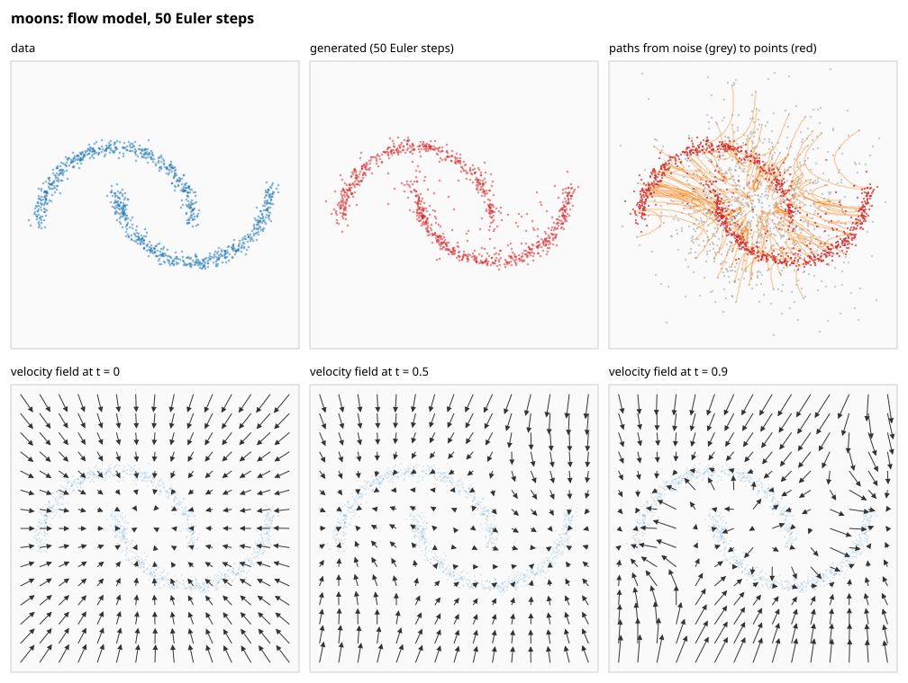
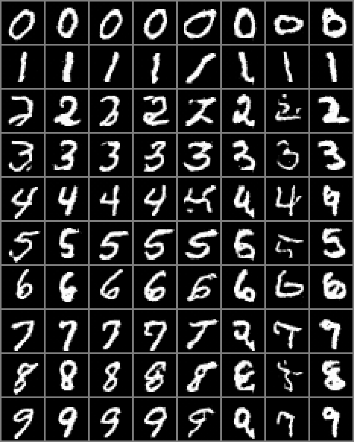
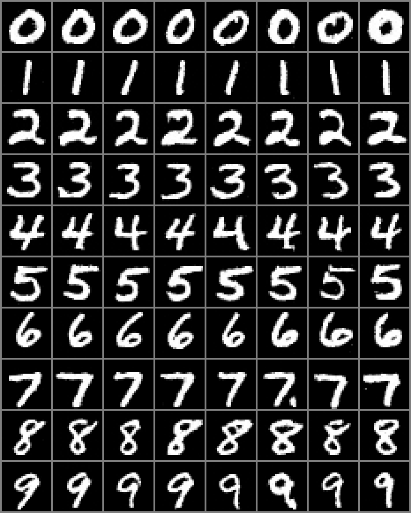
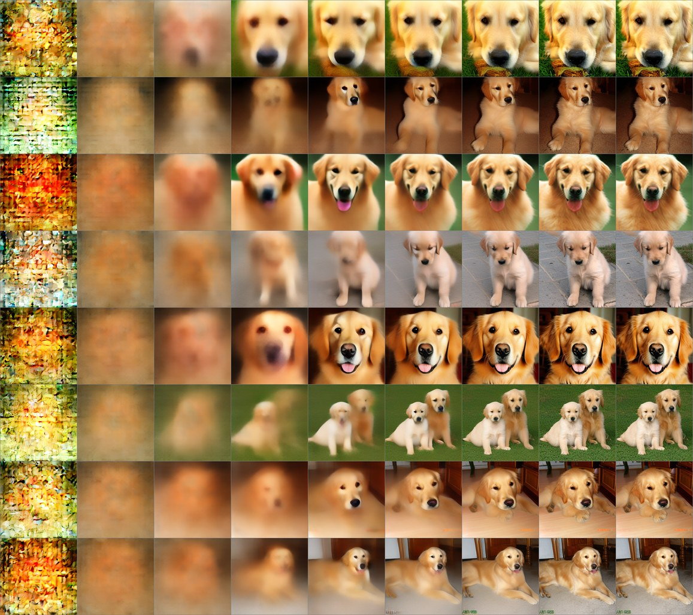

# tiny-diffusion-in-rust: a small diffusion model, built from scratch to learn how image generation works

This project builds a diffusion model by hand, in Rust with no
machine-learning framework, small enough to read and to run on a laptop: the
kind of model that turns random noise into an image by many small steps. It
starts with points in a plane, where every step can be plotted, then moves
to small images of digits, generated by a diffusion transformer (DiT).

It's the companion to
[tiny-llm-in-rust](https://github.com/jlinoff/tiny-llm-in-rust), which did the
same for a language model, and starts from that project's foundation: its
matrices, automatic differentiation and model files.

**Status: six stages done (images on request, a look inside, and a
diffusion language model); stage 7, running a full-scale trained model
through this code, is built and awaiting its first run.** Stage 2 did flow
matching and DDPM (the original diffusion recipe) on 2D data, with plots
of the samples, the paths from noise to data, and the learned velocity
field. Stage 3 trains a 1.8-million-parameter diffusion transformer on
the MNIST handwritten digits (a classic set of 60,000 small images) in
about an hour and a half on a laptop. Stage 4 tells it which digit to
draw, with classifier-free guidance to strengthen the request (an extra
push towards the requested digit, of a strength w set when sampling), and
measures the results with a digit classifier built for the purpose.
Stage 5 looks inside the trained models: what they are drawing at each
moment, how straight their paths are, and where attention looks.
Stage 6 turns to text: a masked diffusion language model, trained on
the same stories as tiny-llm-in-rust's model and compared with it, from
the plateau it first couldn't leave to the stories it writes.
Every stage arrives with its tests, and `make test` and continuous
integration have run from the first commit.



Each panel above comes from a 36,000-parameter network trained in under a
minute: points drawn from noise follow the learned velocity field (bottom
row, at three moments) to land on the two moons.

| Guidance w = 1 | Guidance w = 5 |
|---|---|
|  |  |

The same idea on images, with a request: each row asks the
1.8-million-parameter model (`digits-cond-p4`: labels, 4 × 4 patches)
for one digit, and each column starts from
the same noise, so the noise decides how the digit is written. At
w = 1 (left), 94% of samples are the requested digit and as varied as
real handwriting; at w = 5 (right), all are, bolder and more alike. One
column's noise makes poor digits whatever is asked for, until guidance
rescues it.



Stage 7 runs a full-scale model trained by others, DiT-XL/2 (675 million
parameters), through the same code: each row above is one golden
retriever being generated, the model's guess at eight moments, then the
finished photograph. This image, and the others in `docs/stage7/`, were
generated by DiT-XL/2 and are **not under this project's MIT licence**:
non-commercial use only, with credit to Peebles and Xie (2023); see
[docs/stage7/NOTICE.md](docs/stage7/NOTICE.md).

## PLAN.md: the real documentation

[PLAN.md](PLAN.md) explains everything: what diffusion and flow matching
are, every term defined before use, the stages in order, how each will be
tested, and the design decisions with their reasons. Each stage will record its
predictions before the measurements, including the ones that turn out
wrong.

## Requirements

- Rust 1.87 or later (`cargo`) and GNU make. On macOS, Apple's `make` is
  too old: `brew install make` and use `gmake`.
- Python 3.8 or later, for the tools (standard library only).
- On macOS, Apple's Accelerate library is used for large matrix products
  automatically.

## Try it

```
make moons          # train flow matching on two moons, plot it (out/moons-flow.svg): under a minute
make moons-ddpm     # the same data by DDPM, sampled with DDIM and DDPM's own 1,000 steps
make stage2         # everything of stage 2: moons, rings, spiral, and the exact-field table
make shapes         # stage 3: a small DiT on synthetic 16×16 shapes, no download: minutes
make digits         # stage 3: the DiT on MNIST digits (downloads 10 MB): 1–2 hours on an M4
make peek           # while it trains: samples from its latest checkpoint, out/peek.png and out/peek-progress.png
make classifier     # stage 4: a digit classifier, the instrument that measures generated digits: a minute or two
make measure-stage3 # the classifier's verdict on stage 3's digit models
make digits-cond    # the DiT told which digit to draw (7×7 patches): about half an hour
make guidance       # how the guidance scale trades clarity for variety: a table and a grid per scale
make inside         # stage 5: look inside the trained models: their guesses, paths, guidance's push, attention
make text           # stage 6: a masked diffusion language model on tiny-llm-in-rust's stories, beside its model: about 35 minutes
make text-sample    # its stories at 16, 64 and 256 steps in two orders, infilled stories, and the text measures
make dit-download   # stage 7: show DiT-XL/2's licence; with DIT_LICENSE=accept, download it (non-commercial use only)
make dit            # photographs from DiT-XL/2 through this project's code: an hour or more
make test           # every check: the tests, a smoke test of every command, formatting, lint
make help           # every target, and every variable with its value
```

The plots are SVG (Scalable Vector Graphics) files and the images PNG
(Portable Network Graphics) files; any browser opens both.

## License

MIT: see [LICENSE](LICENSE). This is meant for learning; use it freely.

The repository holds no trained weights from anyone else. Stage 7
downloads two models from their own sources, each under
its own licence: DiT-XL/2 under CC BY-NC 4.0 (non-commercial use only)
and its autoencoder under MIT; PLAN.md, Stage 7, sets out the terms. The
images in `docs/stage7/` were generated by DiT-XL/2 and are excluded
from the MIT licence: see [docs/stage7/NOTICE.md](docs/stage7/NOTICE.md).

## Acknowledgments

Built by Joe in collaboration with **Claude**, Anthropic's AI model (Claude
Opus 5.5), as was tiny-llm-in-rust: Claude writes most of the code and of
PLAN.md, and Joe directs the project, asks the questions that shape it, runs
the long trainings on his Mac, and reviews every change. Commits made
together carry a `Co-Authored-By: Claude` line.
